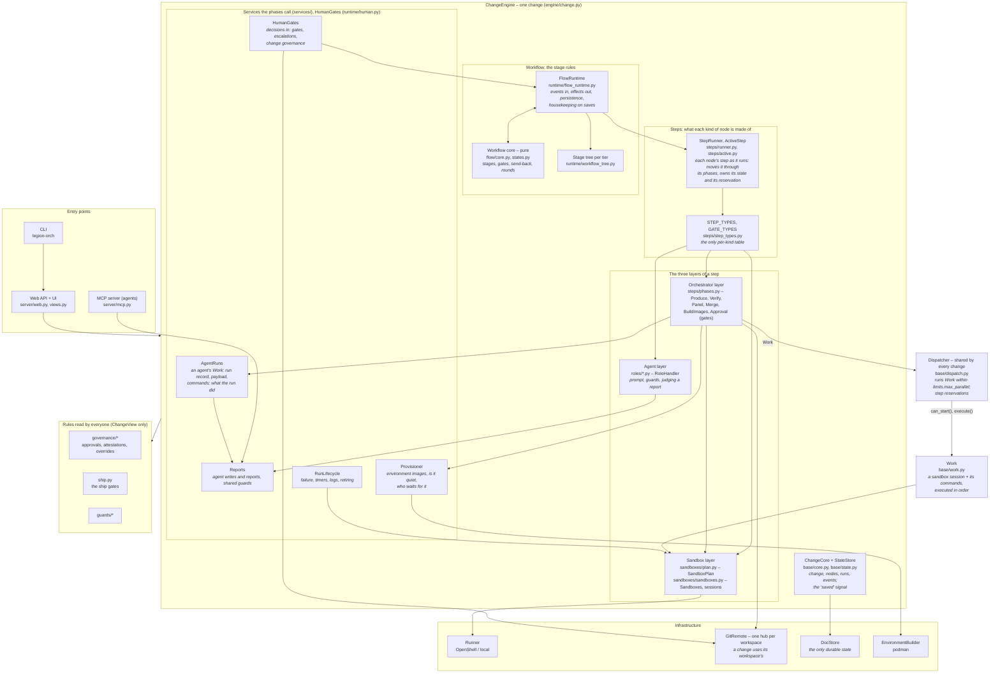
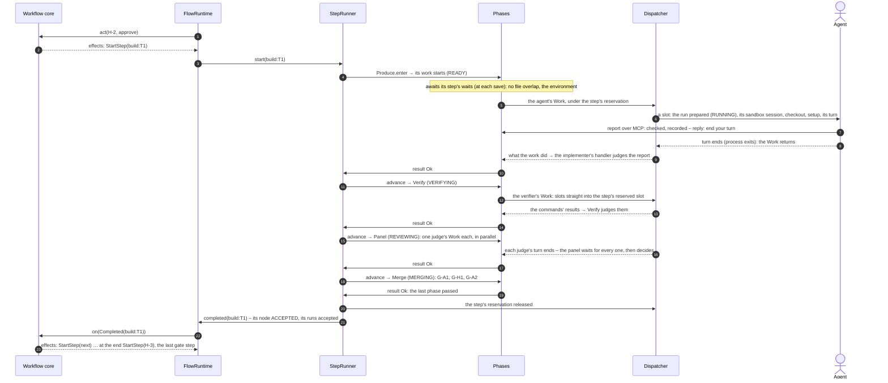
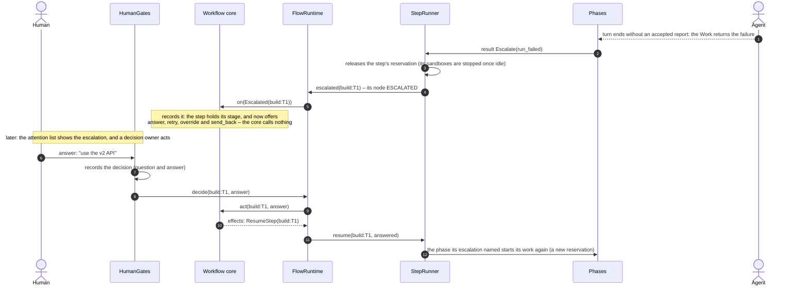
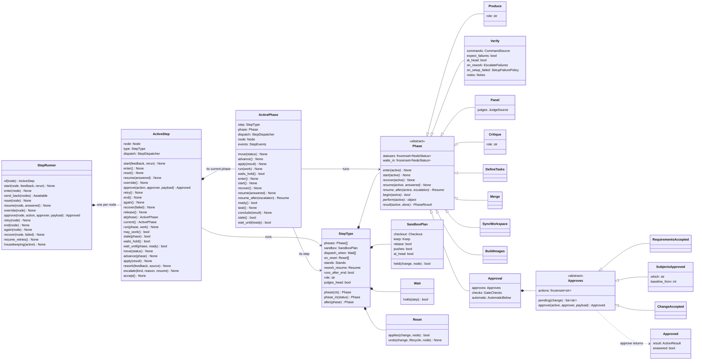
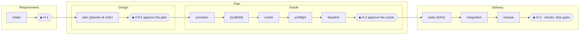
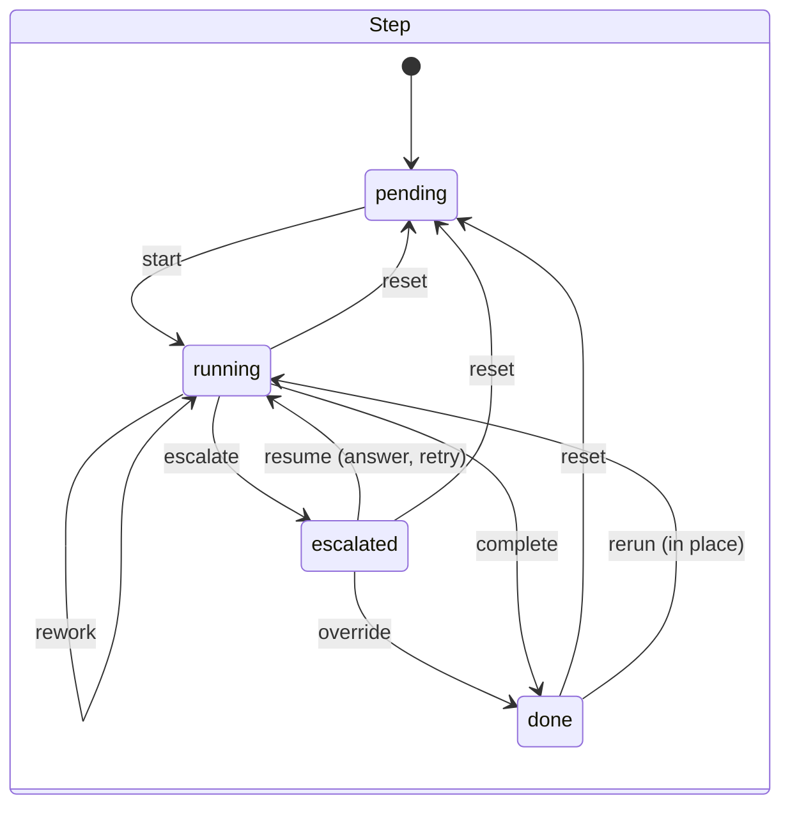

# Architecture: layers and encapsulation

How the controller is put together: which layer decides what, which objects each layer is made
of, and what each object may know about the others. The workflow itself – stages, gates, guards
– is specified in [WORKFLOW.md](../WORKFLOW.md); the plan behind this structure is
"stages and steps" (WORKFLOW.md §4.1).

## 1. The layers

Each layer uses only the layers below it. The **workflow core** at the top of the engine is pure
(no I/O); everything that touches a sandbox, git or the store is below it.

| Layer | Decides | Knows nothing about |
| --- | --- | --- |
| **Workflow core** (`flow/`) | Between steps: what starts when (a stage's gate is its last step), send-backs and their rework policies, fix rounds, the end | Agents, sandboxes, git, the store, node kinds, what a gate checks or who approves it |
| **FlowRuntime** | How the core's effects become node changes; what the nodes' changes mean to the core; persistence by replay | What a step does inside |
| **Steps** (`steps/`) | What each kind of node is made of | How a phase does its work |
| **Phases** | Their own work and its result: ok, rework or escalate | Which kind of node they serve (policies are passed in) |
| **Agent layer** (role handlers) | A role's guards, context, prompt variables, what its report records | Sandboxes, the next phase |
| **Dispatcher** | When work runs: a slot within the limit, a step's reservation | What the work is |
| **Sandbox layer** | Sessions (creating or waking, pausing, deleting), the commands that prepare a working copy, holding, suspending and retiring sandboxes | Why a sandbox is needed |
| **Infrastructure** | Running, storing, versioning | The workflow |

In the code each engine layer is a package of `legion_orch/workflow/engine/`, imported only from
the layers above it (the import contracts in `pyproject.toml`, checked by `lint-imports`):

| Package | Holds |
| --- | --- |
| `runtime/` | `FlowRuntime`, the stage tree, `HumanGates` (decisions in) |
| `steps/` | `StepRunner` and `StepEvents`, `ActiveStep`, the step and gate types, the phases, the node states |
| `services/` | `AgentRuns`, `Reports`, `RunLifecycle`, `Provisioner`, the end-of-change cleanup |
| `sandboxes/` | `Sandboxes` and their sessions, sandbox plans (given as `Plans`), reflections |
| `base/` | `ChangeCore`, `StateStore`, `Services`, node ids, the `Dispatcher` and `Work` |

`compose.py` builds a change's layers; `change.py` (the `ChangeEngine` facade) and
`controller.py` sit on top. The step layer tells the runtime what happened through a protocol it
defines (`StepEvents`), and the sandbox layer learns which plan applies, and whether a role's
environment is being built, through ones it defines (`Plans`, `Environments`): neither imports
the layer above.

## 2. Who decides what: control cascades through the layers

Control passes only between neighbouring layers, left to right in the diagrams below – workflow
core · runtime · step runner · phases · (services and sandboxes) · agent – and each layer keeps
its own responsibility and state. **Down:** the core's effects go to the runtime, which starts,
stops, resets and resumes steps through the step runner, which enters and resumes phases, which
start their work. **Up:** a phase's result (from an agent's report, a verification, a merge, a
failed run) goes to the step runner, which applies it to its node and – when the node crosses
its step's states (done, escalated, resumed, an earlier step redone) – tells the runtime, which
tells the core.

**There is no clock.** A phase's work is a task that awaits what it needs: its step's waits
(checked again at each save of the change – `ChangeCore.next_save`), then a slot from the
dispatcher, then the work itself; then it hands its result up. An agent's run ends when its
agent ends its turn (its process exits); two timers stop an agent that does not: the run
timeout while it is live, and a grace period after its report was accepted. What follows from
the change's state is done on each save (housekeeping): an ended change's retrospective queued
and its cleanup started, kept sandboxes whose hold ended released, a released step's sandboxes
suspended once idle. The controller's only timer sends
the attention reminders.

The participants, left to right:

| Participant | Layer (§1) | Code | Responsible for (and owns) |
| --- | --- | --- | --- |
| **Workflow core** | Workflow: the stage rules | `flow/core.py`, `flow/states.py` | Deciding, without any I/O, which step starts when, what a send-back or a redo resets, what a human may do at an escalated step. Knows only steps – a gate is the step that ends its stage. Owns the steps' and stages' states. |
| **FlowRuntime** | Workflow: the stage rules | `engine/runtime/flow_runtime.py` | Calling the core with what happened (step events, human decisions) and carrying out the effects it returns; housekeeping on each save. Owns the core's record (`workflow.json`), the nodes' existence and order and the retrospective's node. Sees no difference between a gate and any other step. |
| **StepRunner**, **ActiveStep** | Steps | `engine/steps/` (`runner.py`, `active.py`, `node_states.py`, `step_types.py`) | The runner takes the runtime's calls and does what spans steps (a send-back's undoing, retries after a restart, housekeeping); each node's step as it runs is an `ActiveStep`: moving the node through its step type's phases, applying their results (rework within the budget, escalations) and telling the runtime at a step's boundaries; starting each phase's work as a task, and its step's waits. Owns the step nodes' states, as a declared machine nested in the core's (§2.1), and each running step's reservation with the dispatcher (§2.2). |
| **Phases** | Orchestrator layer of a step | `engine/steps/phases.py` (their services, `engine/services/`: `AgentRuns`, `Provisioner`, `RunLifecycle`, `Sandboxes`; their work goes to the `Dispatcher`) | The controller's work around the agent's – producing (an agent's work), verifying, the judges' panel, merging, provisioning – each building its `Work`, dispatching it through its step's dispatcher and ending in a result (ok, rework, escalate, redo) handed to the step runner. |
| **Dispatcher** | Dispatcher (one for every change) | `engine/base/dispatch.py` (the work it runs: `engine/base/work.py`) | Running work – a sandbox session and its commands – when a slot within `limits.max_parallel` is free, first come, first served, and returning its result; it calls only `Work.can_start()` and `Work.execute()` and knows no agents, steps or nodes. Owns the slots and the steps' reservations (a slot kept while a step's work follows straight on, given back while it waits, released when it is over, §2.2). |
| **Agent** | outside the controller | its sandbox; reports over MCP (`server/mcp.py` → `engine/services/reports.py`) | Doing the work, filing one report (checked at once) and ending its turn – which hands control back to its phase. |

A build task, end to end:

An escalation goes up the same way – the core only records it – and, when a human decides,
the decision comes down through every layer:

### 2.1 Two levels of one state

The core's step and the engine's node are two levels of one state: the core's is coarse (is the
step underway?), the node's says where inside it the work is. A node leaves `PENDING` exactly when
its step starts in the core. The node's states are a declared machine (`engine/steps/node_states.py`):
an illegal move raises, only resuming leaves an escalation, and nothing but the step runner
writes a status. Where a step resumes is fixed when it escalates – by the phase it was in, or (a
service's escalation) by that phase on its behalf – and must be one of its step's phases; nothing
above the step layer names a phase: the runtime resumes, overrides (the step's merge) or retries.

| Core step | Engine node |
| --- | --- |
| `pending` | `PENDING` |
| `running` | `READY` (its first work not started yet) · `RUNNING` (its agent works) · `VERIFYING` · `REVIEWING` · `DEFINING` (an accepted plan's tasks defined) · `MERGING` · `REWORK` (its own loop) |
| `escalated` | `ESCALATED` (something went wrong) · `AWAITING_HUMAN` (a decision is due: a gate) |
| `done` | `ACCEPTED` |

**A change's state**, then: the core's record (the tree and its steps' and stages' states,
`workflow.json`), and below it what the engine owns (`ChangeCore`, persisted by `StateStore`) –
the change record, each node's detail (its state inside its step, cycle, commits, verification,
reviews, feedback, escalation, sandbox) and the runs. Which nodes exist, their order and their
dependencies are not stored: they come from the tree.

An agent run is a call and a return: the report is the agent's result, checked as it is filed
(so the agent can fix a rejected one), but nothing moves until the agent **ends its turn** – its
process exits, its work returns, and the run's phase takes what its role handler makes of the
report. A turn that
ends without an accepted report fails the run (escalated); a BLOCKED report escalates; an agent
that keeps going after its report was accepted is stopped after a grace period. The agents are
told so (`harness-contract`).

A rework (`Verify` fails, the panel finds a blocker) stays inside the step: the step runner sends
the node round its own loop and the core only sees the step still running. An escalation is
reported to the core, because a human may answer it by sending a stage back. A step found wanting
by a later one in its stage (preflight's failed setup, for the oracle) is **redone through the
core**: the step and what follows it start again.

### 2.2 Work, the dispatcher and reservations

**Work** (`engine/base/work.py`) is a sandbox session and the commands executed in it, in order.
An agent's run and a verification differ only in their commands:

| Work | Session | Commands |
| --- | --- | --- |
| an agent's run | the run's sandbox: created, or the node's kept one woken and given the new payload; paused after if kept for its session | clone (fresh only), branch or checkout, the repository's setup (a failure is logged, the agent still starts), the agent's turn (with its timers) |
| a verification | a fresh verifier sandbox with a read-only git grant; deleted after | clone, checkout, the repository's setup (a failure stops it, G-V3), each command (all of them) |
| the setup check (provisioning, G-PV3) | as a verification | clone, checkout, the setup |

`Work.execute()` returns each command's result (or why it stopped); what they mean is decided
above it – `Verify` judges a verification's results, `AgentRuns` concludes an agent's report
through its role handler. An agent's work is prepared in its slot: its run record is made
then (or a guard refuses it), so a run never waits for a slot.

**The dispatcher** (`engine/base/dispatch.py`, one for every change) runs work within
`limits.max_parallel` – agent runs and verifier sandboxes – first come, first served, once the
work **can start** (`can_start()`): an agent's or a verifier's work cannot while its role's
environment is being built again, so no sandbox starts from the old build. That is decided
where the work is made – `AgentRuns.work` for its role, `Sandboxes.verifier_work` for the
verifier – by the sandbox layer, which asks the provisioner through a protocol it defines
(`Environments`), as it learns which plan applies through `Plans`. Work that cannot
start keeps its place and holds no slot – a step's idle reserved slot goes back meanwhile – and
the dispatcher looks again whenever a slot or a reservation changes: provisioning ends with its
step accepted and its reservation released, so what waited for the new build starts then.
(Provisioning's own setup check runs in the build it checks: it can always start.) It calls
only `can_start()` and `execute()`.

**A reservation** is a step's claim on one slot, held by the step runner and given to the
step's phases with the dispatcher (a `StepDispatcher`). It binds a slot at the step's first
work and keeps it while work follows straight on – the agent's run, its verification, its
judges – so the verification of finished work never queues behind other steps' new work. Work
dispatched in parallel under it (a panel's judges) takes free unreserved slots or the reserved
one as the work in it completes. While the step **waits on its conditions** (a rework waiting
for an overlapping task, say) it gives the slot back, so a waiting step never
starves the work it waits for; its next work binds one again. The reservation is **released**
when the step is done, sent back, escalated or ended: work still waiting under it is withdrawn,
its slot goes back once the work in it completes, and the step's sandboxes are stopped once
nothing live uses them (a kept one is woken by its next session). A resumed step takes a new
one.

## 3. A step is a composition

A step type is a declaration, not code: an agent (the role of its producer, `Produce(role)`), a sandbox
plan, an ordered list of phases configured by **policy objects**, the waits it respects and what
a reset undoes. Adding a kind of node means adding a row to `STEP_TYPES` (a gate: to
`GATE_TYPES`, which configures each gate's `Approval`: its checks, and what approving it
records, `approves`).

A step type is declared – shared by every node of its kind – and **runs** for one node as an
`ActiveStep`: the step runner makes it from the node, its step type and the runner's services,
and it owns the node's reservation. A **phase** is one class per kind – `Produce`, `Panel`,
`Verify`, `Merge`, `BuildImages`, `Approval`, implementing the abstract `Phase` – holding its
policies and its work together, declared in the table and shared by every node of its kind. As
it runs for a node it is an **`ActivePhase`**: one concrete class, made by the active step from
itself, the phase and – while it works – the step's dispatcher (`ActiveStep.at(phase)`). It is
a phase's whole view of its node: the declarations it runs (`step`, the step type; `phase`), the
node, the change, and what a hook may do (`move`, `advance`, `apply`, `run`) – the running step
itself stays behind it. The
active step works only with active phases (`enter()`, `start()`, `resume(answered)`,
`task()`), and each of the phase's hooks is given the active phase as its one argument for the
node, the change and the step (`perform(active)`, `result(active, done)`) – the phase itself
holds nothing of any node. Everything that lasts is on the node, so active steps and phases
are made again after a restart.

A step type holds only declarations and lookups (`phase_in(status)`, `after(phase)`). A phase
never consults another phase: what it needs from an earlier one is that phase's **evidence**
on the node and in the store – the merge (G-A1) checks the verification's record and the
panel's recorded pass (`PanelDecision`: the candidate, the cycle, the judges that sat and their
reviews' attestations), not which commands or judges those phases have. The policy objects stay
functions of what they are given (a wait: the active step; a command source: the change and
the node).

Every phase's work has one shape (`ActivePhase.task`): once it is **ready** (at once, or at a later
save – the step's slot given back meanwhile) it **begins** (its status, under the lock),
**performs** its work outside the lock (through the step's dispatcher, or a check), and then,
under the lock and unless its step or phase ended meanwhile, its **result** says what the work
means – the one method each phase answers with a `PhaseResult`.

What is the same for every kind is `ActivePhase`'s – the work's shape (`task`), concluding a
result, whether its work still counts, and whether it may begin (`ready`) – and **every hook of
`Phase` is abstract**: each kind says, in one place, how it is entered, started, recovered and
resumed, where it resumes after a service's escalation, and its work's `begin`, `perform` and
`result` (a kind that leaves one out cannot be made).

**Ready** is the same for every phase, from what each declaration states: in the statuses where
its work is the step's first (`waits_in`) the step's waits hold (`dispatch_when`: no file
overlap, a quiet environment, the reflections done). While a phase is not ready the step's
reservation holds no slot; an agent's work whose slot comes once it is no longer ready is
skipped, and waits again. Whether its sandbox's environment is built is its work's own (the
dispatcher starts work only once it can, above) – so a panel's judges each start once their
own role's environment is.

| Phase | waits_in | perform | result |
| --- | --- | --- | --- |
| Produce | READY, REWORK | its agent's work (`agent_work`) | the role handler's, or the failure's escalation |
| Panel | – | every judge still to review, in parallel | their escalations as one, or its decision from the judges' reviews (a pass recorded) |
| Critique | – | the critic's work, as a judge's | its escalation, or its review: PASS is ok, REWORK reworks the plan within the critique budget (G-C2) |
| DefineTasks | – | – | the accepted plan's build tasks defined by the workflow (`StepEvents.define_tasks`), under the lock |
| Verify | READY (at the head) | the verification (`verification`) | recorded, then interpreted with its policies |
| Merge | – | – | the guards and the merge, at once under the lock |
| SyncWorkspace | – | the hub synced (one at a time per hub), what its base holds | based, kept, or unsynced (an escalation) |
| BuildImages | READY | the provisioner's build and setup check | the provisioner's |
| Approval | – | its checks evaluated | approved, still pending, or preconditions unmet |

`enter` is the move into a phase (its first status, then `start`); `start` begins its work for
the status the node is in – on entering, resuming and after a restart.

The table (`engine/steps/step_types.py`) – each kind is a list of phases:

| Kind | Sandbox plan | Phases |
| --- | --- | --- |
| workspace | – | SyncWorkspace (the change's first step) |
| intake | base, kept until H-1 | Produce |
| plan | base, kept until H-E1 | Produce → Critique → DefineTasks |
| provision | – | BuildImages (waits for a quiet environment) |
| oracle | branch (re-based each run), kept until H-2 | Produce (merges itself) |
| preflight | – | Verify(acceptance commands, expect failures, at head, a failed setup → oracle rework) |
| baseline | head | Produce → Verify(baseline commands, expect failures, G-BL2 notes) |
| build | branch, kept until accepted | Produce → Verify(task commands) → Panel(tier) → Merge |
| integration | head | Produce → Verify(oracle commands, a failure escalates) |
| release | head | Produce |
| retrospective | head | Produce (after the change ends, after the last reflections) |
| gate (H-1, H-E1, H-2, H-3) | – | Approval: its checks (H-3: the ship gates), then a human's approval (H-E1, H-2: each subject); below R2, H-3 passes once its checks hold |

Judges (reviewers, the critic) are not node kinds: they are the judges of a `Panel` or the
plan's `Critique` (the same judge's work, `judge_work`), and get the `JUDGE` sandbox plan –
fresh, at the commit they judge (G-D4).

## 4. The workflow core

The change's structure, built once H-1 fixes the tier (R3 shown; lower tiers leave stages out
and approve H-3 automatically):

A **gate** (◆) is the step that ends its stage – the core knows nothing more of it. Its work
(the `Approval` phase) checks what the gate needs and then waits for a human: an expected
escalation (`awaiting_approval`, shown `AWAITING_HUMAN`). Approving it records what the gate's
`approves` says (`steps/approvals.py`: H-1 the tier and panel, H-E1 and H-2 each subject, H-3
the acceptance and the attestations given with it) – `HumanGates` only hands the decision to
`StepRunner.approve` – and once nothing is still to approve it is the *answer* to that
escalation, after which it checks again and passes; unmet checks
escalate again (`preconditions_unmet`) and a re-check is a *retry*. Stages without a human
decision at the tier have no gate: Plan's own, a round's, the oracle's below R2.

**Send back** is offered on an escalated step – a waiting gate included – for every stage its
work was built on. Requirements, Plan, Design and Oracle **start over**; Delivery **appends a round** – a
Round stage (its own Design, Oracle and tasks, ids `@n`) inserted before integration.

**Run again in place** (`rerun:<step>`) is offered on an escalated step for each earlier, done
step declared `rerunnable` – provisioning only: the approved spec built again. That step starts a
new attempt (done → running) while what was built on it stands – nothing is reset, no stage
reopens – and the escalated step is retried; steps that need the environment wait for it.

Every node is one of two small state machines; each status change is a named transition that
declares its source statuses (`flow/states.py`):

## 5. Encapsulation rules

| Boundary | Rule | Checked by |
| --- | --- | --- |
| Workflow core | Pure: no I/O, no engine imports; state only through its machines' transitions | `tests/test_flow.py` (invariants after every event, hypothesis), `test_flow_states.py` |
| FlowRuntime ↔ core | The core's state is its inputs; replaying them rebuilds it exactly | `tests/test_runtime.py` |
| Engine layers | One package per layer – `runtime/` > `steps/` > `services/` > `sandboxes/` > `base/` – importing only downward; `compose.py` alone builds them; the facade (`change.py`) never sees the step layer; nothing outside the engine imports more than `legion_orch.workflow.engine`'s own names | the import contracts in `pyproject.toml` (`lint-imports`; `test_units.py::test_the_engine_keeps_its_layers`), `test_units.py::test_the_facade_names_none_of_the_step_layer` |
| Role handlers | See the change only through `RoleContext`; return their phase's result (ok, rework, escalate) and never move the step or touch a sandbox | `test_units.py::test_role_handlers_use_only_the_role_context`, `tests/test_steps.py` |
| The cascade | Control passes only between neighbouring layers (§2): services return results to their phase, phases to the step runner, the runner tells the runtime (through `StepEvents`, its only view of the layer above), the runtime the core – and back down through the core's effects | `tests/test_runtime.py`, `tests/test_steps.py`, `tests/test_phases.py` |
| Node states | A declared machine nested in the core's step states; only the step runner changes a status or an escalation, only the runtime the change's status | `tests/test_node_states.py` (scans for any other write) |
| Governance, ship gates | Read the change only through `ChangeView` | `test_units.py::test_governance_and_ship_use_only_the_change_view` |
| Per-kind knowledge | Only `STEP_TYPES` and `GATE_TYPES` (what approving each gate records is its `Approval`'s `approves`); no `node.kind` switches elsewhere | `tests/test_steps.py` (the declarations) |
| Dispatcher | Runs opaque work (`can_start()`, `execute()`) within the limit; knows no agents, steps or nodes | `tests/test_dispatch.py` |
| Sandboxes | One owner (`Sandboxes`): locks, sessions, the preparation's commands, pause, hold, suspension, retirement | `tests/test_sandboxes.py` |
| UI | Renders the actions the core offers and the stages it lists; knows no node kinds for actions | `frontend/src/App.test.tsx` |

## 6. Testing each layer

| Layer | Tested with | Needs |
| --- | --- | --- |
| Workflow core | `ScriptedRuntime`: scripted step outcomes, invariants after every event, property tests | nothing |
| Stage tree | the core driven over each tier's tree (`test_workflow_tree.py`) | nothing |
| Phases, step types | scripted runner, builder and judge results (`test_phases.py`, `test_steps.py`) | fake runner |
| Dispatcher | scripted work (`test_dispatch.py`) | nothing |
| Sandboxes | the fake runner (`test_sandboxes.py`) | fake runner |
| FlowRuntime | the engine harness (`test_runtime.py`) | fake runner, real git and store |
| Whole workflow | the engine harness, scripted agents (`test_engine.py` …) and end to end with fake agents over MCP (`test_e2e.py`) | fake runner / local runner |
