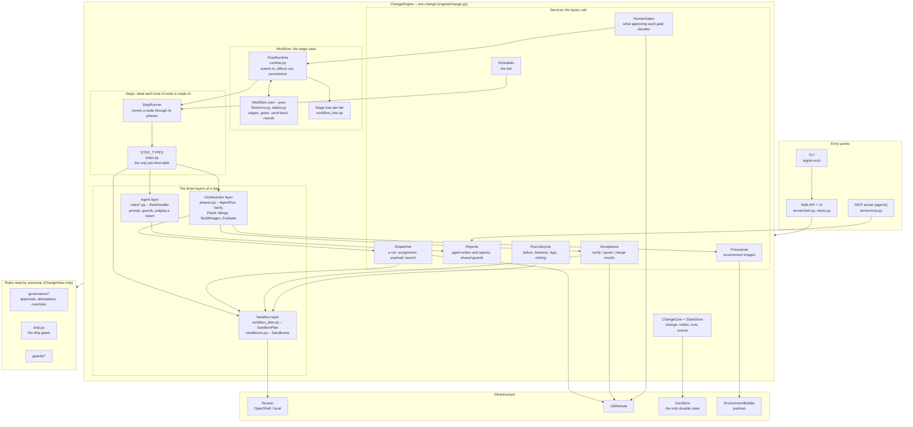
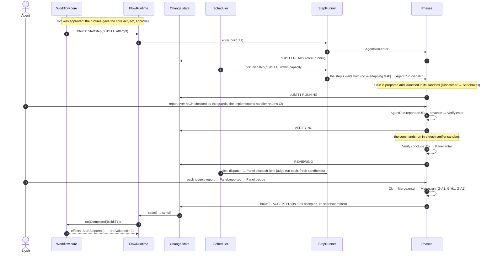
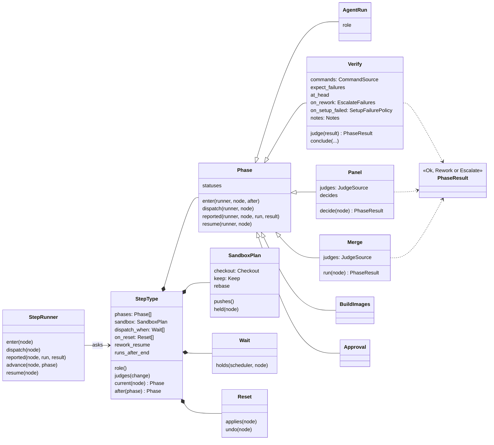
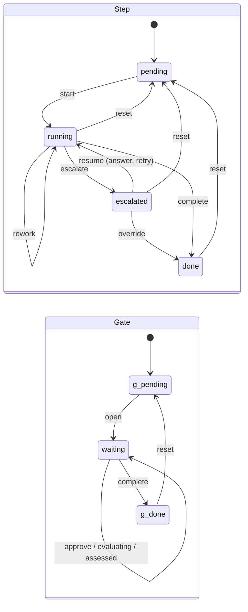

# Architecture: layers and encapsulation

How the controller is put together: which layer decides what, which objects each layer is made
of, and what each object may know about the others. The workflow itself – stages, gates, guards
– is specified in [WORKFLOW.md](../WORKFLOW.md); the plan behind this structure is
"stages and steps" (WORKFLOW.md §4.1).

## 1. The layers

Each layer uses only the layers below it. The **workflow core** at the top of the engine is pure
(no I/O); everything that touches a sandbox, git or the store is below it.

| Layer | Decides | Knows nothing about |
| --- | --- | --- |
| **Workflow core** (`flow/`) | Between steps: what starts when, gates (approval + preconditions), send-backs and their rework policies, fix rounds, the end | Agents, sandboxes, git, the store, node kinds |
| **FlowRuntime** | How the core's effects become node changes; what the nodes' changes mean to the core; persistence by replay | What a step does inside |
| **Steps** (`steps.py`) | What each kind of node is made of | How a phase does its work |
| **Phases** | Their own work and its result: ok, rework or escalate | Which kind of node they serve (policies are passed in) |
| **Agent layer** (role handlers) | A role's guards, context, prompt variables, what its report records | Sandboxes, the next phase |
| **Sandbox layer** | Creating, preparing, pausing, holding and retiring sandboxes; verifiers | Why a sandbox is needed |
| **Infrastructure** | Running, storing, versioning | The workflow |

## 2. Who decides what: a build task, end to end

Between steps the core decides; within a step the engine does. The core is a pure object: it
never calls anything. **FlowRuntime calls it** – with an event (`on(Completed(...))`) or a human's
action (`act(...)`) – and the core **returns its effects** (`StartStep`, `StopStep`, `Evaluate`,
`EndChange`), which the runtime carries out. The way back is the **change's state**: a phase sets
its node's status, the change is saved, and every save first runs `FlowRuntime.sync`, which
compares the nodes with the core's steps and tells the core what changed (accepted →
`Completed`, escalated → `Escalated`, resolved → resumed). Every state change, wherever it is
made, passes through that one save.

The participants, left to right:

| Participant | Layer (§1) | Code | Responsible for |
| --- | --- | --- | --- |
| **Agent** | outside the controller | its sandbox, over MCP (`server/mcp.py` → `engine/reports.py`) | Doing the work and reporting it; its report is checked by the shared guards and judged by its role handler, which returns what it means to its phase. |
| **Workflow core** | Workflow: the stage rules | `flow/core.py`, `flow/states.py` | Deciding, without any I/O, which step starts when, when a gate waits or completes, and what a send-back resets – between steps. |
| **FlowRuntime** | Workflow: the stage rules | `engine/runtime.py` | Calling the core with what happened, carrying out the effects it returns on the change's nodes, and persisting the core as its inputs. |
| **Change state** | Engine | `engine/core.py` (`ChangeCore`), `engine/state.py` | The change, its nodes and runs; `save()` persists them, after letting the workflow see what changed. |
| **Scheduler** | Services | `engine/schedule.py` | The tick: starting the work that current phases may start now, within the parallel-run limit; failing timed-out runs; releasing sandboxes. |
| **StepRunner** | Steps | `engine/steps.py` | Moving one node through its step type's phases: entering the first, checking the step's waits, passing results to the phase, advancing, accepting after the last. |
| **Phases** | Orchestrator layer of a step | `engine/phases.py` (with `Dispatcher`, `Acceptance`, `Provisioner`, and `Sandboxes` below them) | The controller's work around the agent's – dispatching it, verifying, the judges' panel, merging – each ending in ok, rework or escalate. |

The core's step and the engine's node are two levels of one state: the core's is coarse (is the
step underway?), the node's says where inside it the work is. A node leaves `PENDING` exactly when
its step starts in the core:

| Core step | Engine node |
| --- | --- |
| `pending` | `PENDING` |
| `running` | `READY` (its first work not started yet) · `RUNNING` (its agent works) · `VERIFYING` · `REVIEWING` · `MERGING` · `REWORK` (its own loop) |
| `escalated` | `ESCALATED` |
| `done` | `ACCEPTED` |

A rework (`Verify` fails, the panel finds a blocker) stays inside the step: the engine runs the
agent again in the same branch and sandbox, and the core only sees the step still running. An
escalation is the only within-step event the core is told about, because a human may answer it
by sending a stage back. The node statuses inside `running` are set by the phases; unlike the
core's, they are not yet a declared state machine.

## 3. A step is a composition

A step type is a declaration, not code: an agent (the role of its first `AgentRun`), a sandbox
plan, an ordered list of phases configured by **policy objects**, the waits it respects and what
a reset undoes. Adding a kind of node means adding a row to `STEP_TYPES`.

The table (`engine/steps.py`) – each kind is a list of phases:

| Kind | Sandbox plan | Phases |
| --- | --- | --- |
| intake | base, kept until H-1 | AgentRun |
| plan | base, kept until H-E1 | AgentRun → Panel(critic, decided by its handler) |
| provision | – | BuildImages (its dispatch waits for a quiet environment) |
| oracle | branch (re-based each run), kept until H-2 | AgentRun (merges itself) |
| preflight | – | Verify(acceptance commands, expect failures, at head, a failed setup → oracle rework) |
| baseline | head | AgentRun → Verify(baseline commands, expect failures, G-BL2 notes) |
| build | branch, kept until accepted | AgentRun → Verify(task commands) → Panel(tier) → Merge |
| integration | head | AgentRun → Verify(oracle commands, a failure escalates) |
| release | head | AgentRun |
| retrospective | head | AgentRun (after the change ends, after the last reflections) |
| human gate | – | Approval |

Judges (reviewers, the critic) are not node kinds: they are the judges of a `Panel`, and get the
`JUDGE` sandbox plan – fresh, at the commit they judge (G-D4).

## 4. The workflow core

The change's structure, built once H-1 fixes the tier (R3 shown; lower tiers leave stages out
and approve H-3 automatically):

```mermaid
flowchart LR
    subgraph REQ["Requirements"]
        intake --> H1{{"◆ H-1"}}
    end
    subgraph PLAN["Plan"]
        subgraph DES["Design"]
            plan["plan (planner ⇄ critic)"] --> HE1{{"◆ H-E1 approve the plan"}}
        end
        subgraph ORC["Oracle"]
            provision --> scaffold["[scaffold]"] --> oracle --> preflight --> baseline --> H2{{"◆ H-2 approve the oracle"}}
        end
        HE1 --> provision
        H2 --> PG{{"◆ plan-approved (automatic)"}}
    end
    subgraph DEL["Delivery"]
        tasks["tasks (DAG)"] --> integration --> release --> H3{{"◆ H-3 · preconditions: ship gates"}}
    end
    H1 --> plan
    PG --> tasks
```

**Send back** is offered on a waiting gate or an escalated step for every stage its work was
built on. Requirements, Plan, Design and Oracle **start over**; Delivery **appends a round** – a
Round stage (its own Design, Oracle and tasks, ids `@n`) inserted before integration.

Every node is one of three small state machines; each status change is a named transition that
declares its source statuses (`flow/states.py`):

## 5. Encapsulation rules

| Boundary | Rule | Checked by |
| --- | --- | --- |
| Workflow core | Pure: no I/O, no engine imports; state only through its machines' transitions | `tests/test_flow.py` (invariants after every event, hypothesis), `test_flow_states.py` |
| FlowRuntime ↔ core | The core's state is its inputs; replaying them rebuilds it exactly | `tests/test_runtime.py` |
| Engine collaborators | Each gets only the parts it uses; imports form a DAG; nothing imports the `ChangeEngine` facade | `test_units.py::test_engine_collaborators_are_acyclic` |
| Role handlers | See the change only through `RoleContext`; return their phase's result (ok, rework, escalate) and never move the step or touch a sandbox | `test_units.py::test_role_handlers_use_only_the_role_context`, `tests/test_steps.py` |
| Governance, ship gates | Read the change only through `ChangeView` | `test_units.py::test_governance_and_ship_use_only_the_change_view` |
| Per-kind knowledge | Only `STEP_TYPES` (and gate approvals in `HumanGates`); no `node.kind` switches elsewhere | `tests/test_steps.py` (the declarations) |
| Sandboxes | One owner (`Sandboxes`): locks, creation, preparation, pause, hold, retirement | `tests/test_sandboxes.py` |
| UI | Renders the actions the core offers and the stages it lists; knows no node kinds for actions | `frontend/src/App.test.tsx` |

## 6. Testing each layer

| Layer | Tested with | Needs |
| --- | --- | --- |
| Workflow core | `ScriptedRuntime`: scripted step outcomes, invariants after every event, property tests | nothing |
| Stage tree | the core driven over each tier's tree (`test_workflow_tree.py`) | nothing |
| Phases, step types | scripted runner, builder and judge results (`test_phases.py`, `test_steps.py`) | fake runner |
| Sandboxes | the fake runner (`test_sandboxes.py`) | fake runner |
| FlowRuntime | the engine harness (`test_runtime.py`) | fake runner, real git and store |
| Whole workflow | the engine harness, scripted agents (`test_engine.py` …) and end to end with fake agents over MCP (`test_e2e.py`) | fake runner / local runner |
