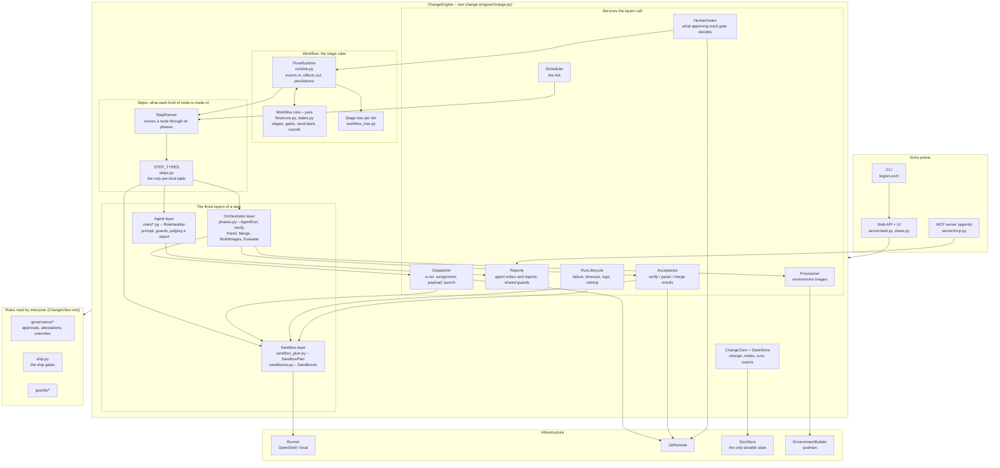
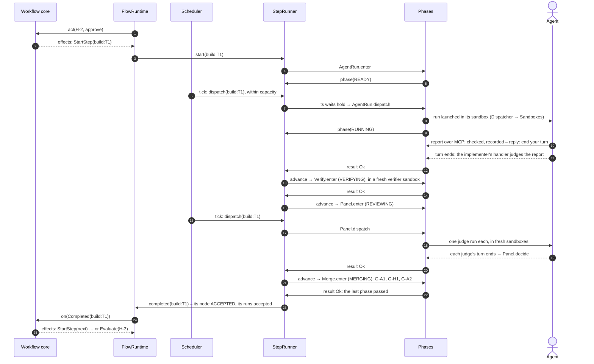
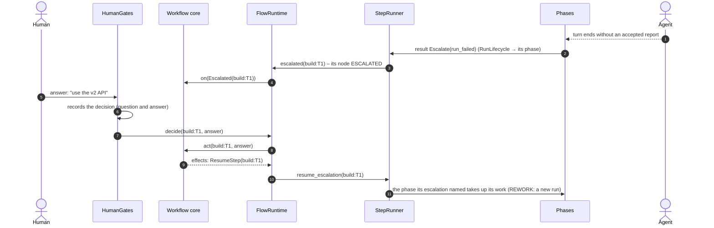
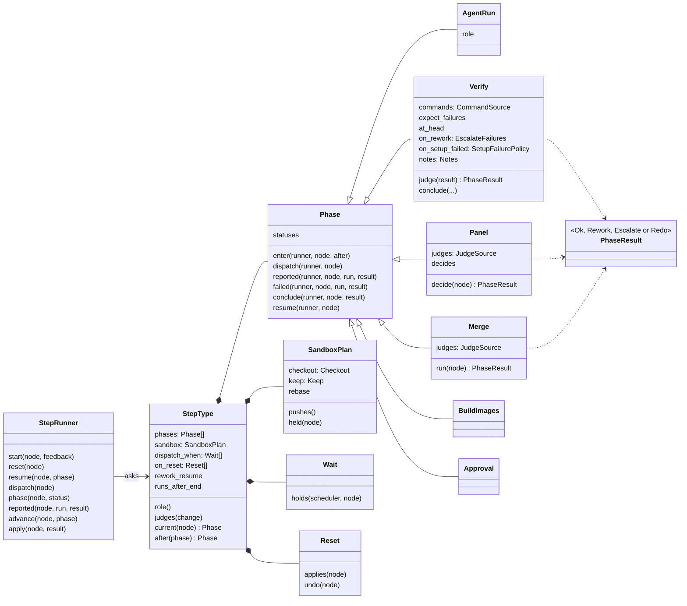
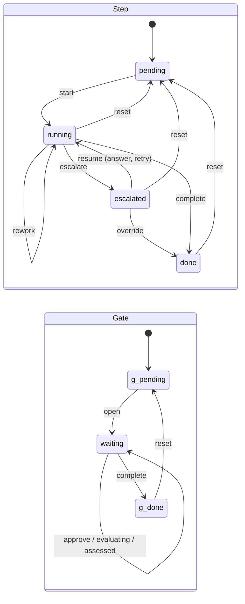

# Architecture: layers and encapsulation

How the controller is put together: which layer decides what, which objects each layer is made
of, and what each object may know about the others. The workflow itself – stages, gates, guards
– is specified in [WORKFLOW.md](../WORKFLOW.md); the plan behind this structure is
"stages and steps" (WORKFLOW.md §4.1).

## 1. The layers

Each layer uses only the layers below it. The **workflow core** at the top of the engine is pure
(no I/O); everything that touches a sandbox, git or the store is below it.

| Layer | Decides | Knows nothing about |
| --- | --- | --- |
| **Workflow core** (`flow/`) | Between steps: what starts when, gates (approval + preconditions), send-backs and their rework policies, fix rounds, the end | Agents, sandboxes, git, the store, node kinds |
| **FlowRuntime** | How the core's effects become node changes; what the nodes' changes mean to the core; persistence by replay | What a step does inside |
| **Steps** (`steps.py`) | What each kind of node is made of | How a phase does its work |
| **Phases** | Their own work and its result: ok, rework or escalate | Which kind of node they serve (policies are passed in) |
| **Agent layer** (role handlers) | A role's guards, context, prompt variables, what its report records | Sandboxes, the next phase |
| **Sandbox layer** | Creating, preparing, pausing, holding and retiring sandboxes; verifiers | Why a sandbox is needed |
| **Infrastructure** | Running, storing, versioning | The workflow |

## 2. Who decides what: control cascades through the layers

Control passes only between neighbouring layers, left to right in the diagrams below – workflow
core · runtime · step runner · phases · (services and sandboxes) · agent – and each layer keeps
its own responsibility and state. **Down:** the core's effects go to the runtime, which starts,
stops, resets and resumes steps through the step runner, which enters and resumes phases, which
start their work. **Up:** a phase's result (from an agent's report, a verification, a merge, a
failed run) goes to the step runner, which applies it to its node and – when the node crosses
its step's states (done, escalated, resumed, an earlier step redone) – tells the runtime, which
tells the core. The scheduler is the clock: it only asks the step runner what may start now.

The participants, left to right:

| Participant | Layer (§1) | Code | Responsible for (and owns) |
| --- | --- | --- | --- |
| **Workflow core** | Workflow: the stage rules | `flow/core.py`, `flow/states.py` | Deciding, without any I/O, which step starts when, when a gate waits or completes, what a send-back or a redo resets. Owns the steps' and gates' states. |
| **FlowRuntime** | Workflow: the stage rules | `engine/runtime.py` | Calling the core with what happened (step events, human decisions) and carrying out the effects it returns. Owns the core's record (`workflow.json`) and the gate nodes, which follow their gates. |
| **Scheduler** | the clock | `engine/schedule.py` | Each tick: asking the step runner what may start now, within the parallel-run limit; timeouts; releasing sandboxes; starting a requested reprovisioning. Owns no state of the workflow. |
| **StepRunner** | Steps | `engine/steps.py`, `engine/node_states.py` | Moving a node through its step type's phases, applying their results (rework within the budget, escalations) and telling the runtime at a step's boundaries. Owns the step nodes' states, as a declared machine nested in the core's (§2.1). |
| **Phases** | Orchestrator layer of a step | `engine/phases.py` (their services: `Dispatcher`, `Acceptance`, `Provisioner`, `RunLifecycle`, and `Sandboxes` below them) | The controller's work around the agent's – dispatching it, verifying, the judges' panel, merging, provisioning – each ending in a result (ok, rework, escalate, redo) handed to the step runner. |
| **Agent** | outside the controller | its sandbox; reports over MCP (`server/mcp.py` → `engine/reports.py`) | Doing the work, filing one report (checked at once) and ending its turn – which hands control back to its phase. |

A build task, end to end:

An escalation goes up the same way, and the human's decision comes down through every layer:

### 2.1 Two levels of one state

The core's step and the engine's node are two levels of one state: the core's is coarse (is the
step underway?), the node's says where inside it the work is. A node leaves `PENDING` exactly when
its step starts in the core. The node's states are a declared machine (`engine/node_states.py`):
an illegal move raises, only resuming leaves an escalation, and nothing but the step runner
(step nodes) and the runtime (gate nodes) writes a status.

| Core step | Engine node |
| --- | --- |
| `pending` | `PENDING` |
| `running` | `READY` (its first work not started yet) · `RUNNING` (its agent works) · `VERIFYING` · `REVIEWING` · `MERGING` · `REWORK` (its own loop) |
| `escalated` | `ESCALATED` |
| `done` | `ACCEPTED` |

**A change's state**, then: the core's record (the tree and its steps' and gates' states,
`workflow.json`), and below it what the engine owns (`ChangeCore`, persisted by `StateStore`) –
the change record, each node's detail (its state inside its step, cycle, commits, verification,
reviews, feedback, escalation, sandbox) and the runs. Which nodes exist, their order and their
dependencies are not stored: they come from the tree.

An agent run is a call and a return: the report is the agent's result, checked as it is filed
(so the agent can fix a rejected one), but nothing moves until the agent **ends its turn** – its
process exits, and the run's phase takes what its role handler makes of the report. A turn that
ends without an accepted report fails the run (escalated); a BLOCKED report escalates; an agent
that keeps going after its report was accepted is stopped after a grace period. The agents are
told so (`harness-contract`).

A rework (`Verify` fails, the panel finds a blocker) stays inside the step: the step runner sends
the node round its own loop and the core only sees the step still running. An escalation is
reported to the core, because a human may answer it by sending a stage back. A step found wanting
by a later one in its stage (preflight's failed setup, for the oracle) is **redone through the
core**: the step and what follows it start again.

## 3. A step is a composition

A step type is a declaration, not code: an agent (the role of its first `AgentRun`), a sandbox
plan, an ordered list of phases configured by **policy objects**, the waits it respects and what
a reset undoes. Adding a kind of node means adding a row to `STEP_TYPES`.

The table (`engine/steps.py`) – each kind is a list of phases:

| Kind | Sandbox plan | Phases |
| --- | --- | --- |
| intake | base, kept until H-1 | AgentRun |
| plan | base, kept until H-E1 | AgentRun → Panel(critic, decided by its handler) |
| provision | – | BuildImages (its dispatch waits for a quiet environment) |
| oracle | branch (re-based each run), kept until H-2 | AgentRun (merges itself) |
| preflight | – | Verify(acceptance commands, expect failures, at head, a failed setup → oracle rework) |
| baseline | head | AgentRun → Verify(baseline commands, expect failures, G-BL2 notes) |
| build | branch, kept until accepted | AgentRun → Verify(task commands) → Panel(tier) → Merge |
| integration | head | AgentRun → Verify(oracle commands, a failure escalates) |
| release | head | AgentRun |
| retrospective | head | AgentRun (after the change ends, after the last reflections) |
| human gate | – | Approval |

Judges (reviewers, the critic) are not node kinds: they are the judges of a `Panel`, and get the
`JUDGE` sandbox plan – fresh, at the commit they judge (G-D4).

## 4. The workflow core

The change's structure, built once H-1 fixes the tier (R3 shown; lower tiers leave stages out
and approve H-3 automatically):

```mermaid
flowchart LR
    subgraph REQ["Requirements"]
        intake --> H1{{"◆ H-1"}}
    end
    subgraph PLAN["Plan"]
        subgraph DES["Design"]
            plan["plan (planner ⇄ critic)"] --> HE1{{"◆ H-E1 approve the plan"}}
        end
        subgraph ORC["Oracle"]
            provision --> scaffold["[scaffold]"] --> oracle --> preflight --> baseline --> H2{{"◆ H-2 approve the oracle"}}
        end
        HE1 --> provision
        H2 --> PG{{"◆ plan-approved (automatic)"}}
    end
    subgraph DEL["Delivery"]
        tasks["tasks (DAG)"] --> integration --> release --> H3{{"◆ H-3 · preconditions: ship gates"}}
    end
    H1 --> plan
    PG --> tasks
```

**Send back** is offered on a waiting gate or an escalated step for every stage its work was
built on. Requirements, Plan, Design and Oracle **start over**; Delivery **appends a round** – a
Round stage (its own Design, Oracle and tasks, ids `@n`) inserted before integration.

Every node is one of three small state machines; each status change is a named transition that
declares its source statuses (`flow/states.py`):

## 5. Encapsulation rules

| Boundary | Rule | Checked by |
| --- | --- | --- |
| Workflow core | Pure: no I/O, no engine imports; state only through its machines' transitions | `tests/test_flow.py` (invariants after every event, hypothesis), `test_flow_states.py` |
| FlowRuntime ↔ core | The core's state is its inputs; replaying them rebuilds it exactly | `tests/test_runtime.py` |
| Engine collaborators | Each gets only the parts it uses; imports form a DAG; nothing imports the `ChangeEngine` facade | `test_units.py::test_engine_collaborators_are_acyclic` |
| Role handlers | See the change only through `RoleContext`; return their phase's result (ok, rework, escalate) and never move the step or touch a sandbox | `test_units.py::test_role_handlers_use_only_the_role_context`, `tests/test_steps.py` |
| The cascade | Control passes only between neighbouring layers (§2): services return results to their phase, phases to the step runner, the runner to the runtime, the runtime to the core – and back down through the core's effects | `tests/test_runtime.py`, `tests/test_steps.py`, `tests/test_phases.py` |
| Node states | A declared machine nested in the core's step states; only the step runner (steps) and the runtime (gates) change a status | `tests/test_node_states.py` (including a scan for any other write) |
| Governance, ship gates | Read the change only through `ChangeView` | `test_units.py::test_governance_and_ship_use_only_the_change_view` |
| Per-kind knowledge | Only `STEP_TYPES` (and gate approvals in `HumanGates`); no `node.kind` switches elsewhere | `tests/test_steps.py` (the declarations) |
| Sandboxes | One owner (`Sandboxes`): locks, creation, preparation, pause, hold, retirement | `tests/test_sandboxes.py` |
| UI | Renders the actions the core offers and the stages it lists; knows no node kinds for actions | `frontend/src/App.test.tsx` |

## 6. Testing each layer

| Layer | Tested with | Needs |
| --- | --- | --- |
| Workflow core | `ScriptedRuntime`: scripted step outcomes, invariants after every event, property tests | nothing |
| Stage tree | the core driven over each tier's tree (`test_workflow_tree.py`) | nothing |
| Phases, step types | scripted runner, builder and judge results (`test_phases.py`, `test_steps.py`) | fake runner |
| Sandboxes | the fake runner (`test_sandboxes.py`) | fake runner |
| FlowRuntime | the engine harness (`test_runtime.py`) | fake runner, real git and store |
| Whole workflow | the engine harness, scripted agents (`test_engine.py` …) and end to end with fake agents over MCP (`test_e2e.py`) | fake runner / local runner |
