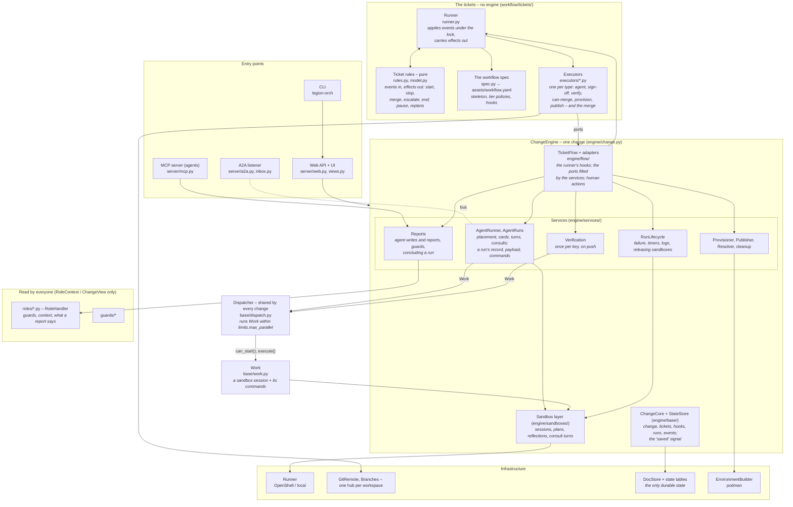
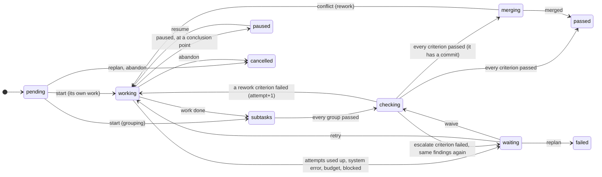

# Architecture: layers and encapsulation

How the controller is put together: which layer decides what, which objects each layer is made
of, and what each object may know about the others. The workflow itself – the tickets, their
guards, the tier policies – is specified in [WORKFLOW.md](../WORKFLOW.md) (§4 for the ticket
model); the plans behind this structure are `~/plans/tickets-design.md` and
`~/plans/tickets-3b.md`.

## 1. The layers

Each layer uses only the layers below it. The **ticket rules** at the top are pure (no I/O);
everything that touches a sandbox, git or the store is below them, reached through the
executors' ports.



| Layer | Decides | Knows nothing about |
| --- | --- | --- |
| **Ticket rules** (`tickets/rules.py`) | What a ticket does next: its work, its subtask groups, its criteria in order; rework or escalate; merges, waiting and remedies; pause; applying a replan; the end | Agents, sandboxes, git, the store, roles, I/O of any kind |
| **Runner** (`tickets/runner.py`) | Applying each event to the rules under the change's lock and carrying out their effects: a ticket's `Work` (its branch, base, judged commit), its executor's run as a task, merges, sign-offs that apply a replan, recovery | What an executor does; the engine (it is given `Hooks`) |
| **Executors** (`tickets/executors/`) | One ticket type's own work, ending in one outcome (`Done`, `Judged`, `GaveUp`, `Blocked`, `Fault`, `OverBudget`); retrying faults with backoff | The services behind their ports |
| **TicketFlow** (`engine/flow/`) | The runner's hooks (the tier, the replan a sign-off applies, a ticket's work checked against its role, escalations, the end, the on-complete process) and the decision owners' actions; the adapters fill the executors' ports with the services | How a service does its work |
| **Services** (`engine/services/`) | An agent's run (placement, payload, turns, report, conclusion), verifications, provisioning, publishing, the resolver, cleanup | Ticket rules, the next ticket |
| **Role handlers** (`workflow/roles/`) | A role's guards, context, prompt variables, what its accepted report says (commit, outputs, verdict, findings) | Sandboxes, the ticket's next state |
| **Dispatcher** | When work runs: a slot within the limit | What the work is |
| **Sandbox layer** | Sessions (creating or waking, pausing, deleting), the commands that prepare a working copy, holding, suspending and retiring sandboxes, consult turns | Why a sandbox is needed |
| **Infrastructure** | Running, storing, versioning | The workflow |

In the code each engine layer is a package of `legion_orch/workflow/engine/`, imported only from
the layers above it, and the tickets are a package of their own that imports no engine (the
import contracts in `pyproject.toml`, checked by `lint-imports`):

| Package | Holds |
| --- | --- |
| `workflow/tickets/` | the ticket model and rules, the spec (`workflow.yaml`), named outputs and their resolution, the replan document, the runner, the executors and their ports, the tickets' persistence (`store.py`) |
| `engine/flow/` | `TicketFlow` (the change's workflow: start, recover, hooks, human actions, housekeeping) and the adapters (`Agents`, `Signoffs`, `Verify`, `Provision`, `Remote`) |
| `engine/services/` | `AgentRunner` (the workflow's one counterpart for agents: cards, work, A2A turns, placement; `services/agents/`), `AgentRuns`, `Reports`, `RunLifecycle`, the verification service, `Provisioner`, `Publisher`, the resolver, the end-of-change cleanup |
| `engine/sandboxes/` | `Sandboxes` and their sessions, sandbox plans (`plan_for(ticket)`), reflections, consult turns |
| `engine/base/` | `ChangeCore`, `StateStore` (the change's records: live in the state tables, `store/state_tables.py`; history in an append-only JSON Lines journal, `store/journal.py`), `Services`, projections, auth, the `Dispatcher` and `Work` |

`compose.py` builds a change's layers; `change.py` (the `ChangeEngine` facade) and
`controller.py` sit on top. The facade fronts the workflow (`TicketFlow`), the agents' reports and
the run logs, and never sees the sandbox layer. The sandbox layer learns whether a role's
environment is being built through a protocol it defines (`Environments`): it imports no layer
above.

## 2. Who decides what: control cascades through the layers

Control passes only between neighbouring layers – rules · runner · executor · adapter · service
(and sandboxes) · agent – and each keeps its own responsibility and state. **Down:** the rules'
effects go to the runner, which starts an executor's run for a ticket's `Work`, which calls its
port, which the adapter answers with a service, which starts its work in a dispatcher slot.
**Up:** the work's result (an agent's concluded report, a verification, a merge, a failed run)
returns through the service to the adapter, which hands its executor what it means (an
`AgentEnd`, a `Verification`); the executor ends in one outcome; the runner turns it into the
rules' event (`apply`) under the change's lock; the rules return the next effects.

**There is no clock.** An executor's run is a task that awaits what it needs: a slot from the
dispatcher, then the work itself; then it hands its outcome up. An agent's run ends when its
agent ends its turn (its process exits); two timers stop an agent that does not: the run
timeout while it is live, and a grace period after its report was accepted. What follows from
the change's state is done on each save (`TicketFlow.housekeeping`): closed tickets' sandboxes
released (after their agents reflect), merged ticket branches deleted, idle sandboxes suspended,
an ended change's cleanup. The controller's only timer sends the attention reminders.

A build, end to end:

```mermaid
sequenceDiagram
    autonumber
    participant Rules as Ticket rules
    participant R as Runner
    participant X as Executors
    participant A as Adapters + services
    participant D as Dispatcher
    actor Agent

    Note over Rules: H-2 passed: delivery's first group starts
    Rules-->>R: effects: StartWork(T1)
    R->>X: agent executor: Work(T1, attempt 1, branch legion/c/t/T1, base)
    X->>A: AgentPort.run(implementer, work)
    A->>D: the agent's Work (its sandbox plan: kept, on its branch)
    D->>Agent: a slot: the run prepared, its sandbox session, checkout, setup, its turn
    Agent->>A: report over MCP: checked, recorded – reply: end your turn
    Agent-->>D: turn ends (process exits): the Work returns
    A-->>X: Reports.conclude → AgentEnd(accepted, sha, outputs)
    X-->>R: Done(sha)
    R->>Rules: work_done(T1, sha)
    Rules-->>R: effects: StartWork(verify:T1)
    R->>X: verify executor at sha → VerifyPort → the verification service
    X-->>R: Judged(pass)
    R->>Rules: verdict(verify:T1, pass) → StartWork(review:T1) … StartWork(can-merge:T1)
    Note over Rules,R: every criterion passed
    Rules-->>R: effects: Merge(T1 → integration)
    R->>X: the merger: checked and merged under the branch's lock
    R->>Rules: merged(T1, head) → T1 passed; the next group or the integration starts
```

An escalation goes up the same way, and a human's remedy comes down as an event:

```mermaid
sequenceDiagram
    autonumber
    actor Human
    participant F as TicketFlow
    participant R as Runner
    participant Rules as Ticket rules
    participant X as Executors
    actor Agent

    Agent-->>X: turn ends with a BLOCKED report: Blocked(why)
    X-->>R: the outcome
    R->>Rules: blocked(T1) → T1 waiting (blocked)
    Rules-->>R: effects: Escalate(T1)
    R->>F: hooks.escalated(T1): an event, attention; the save raises Escalated on the bus
    Note over F: the resolver hears it and proposes a remedy
    Human->>F: act(T1, retry, answer: "use the v2 API")
    F->>F: the answer joins T1's findings
    F->>R: decide(T1, retry)
    R->>Rules: decide(T1, retry) → T1 working (same attempt)
    Rules-->>R: effects: StartWork(T1)
    R->>X: a new round: the agent resumed in its kept sandbox, told the answer
```

### 2.1 The tickets are the state

A change's state is its tickets – the tree's definitions and each ticket's state (status,
attempt, commit, findings, waiting reason, outputs, runs, kept sandbox) – the change record (with
its pointers), the side processes outside the tree (`hooks`: the retrospective) and the runs,
kept by `StateStore`: a save updates their rows in the state tables and appends what changed to
the journal; a load reads the tables. Nothing is snapshotted or replayed: there is no other state
to restore. Documents an agent wrote and the controller's records (sign-offs, verifications, run
documents) are projected onto the change as they are written and on load.

Only the rules change a ticket's status: the runner applies events to them and the engine reads
the tickets. The runner saves the rules' state before it carries out their effects, so a crash
between the two is a recovery, not a loss: after a restart (`Runner.recover`) every working
ticket's executor runs again at the same attempt – an agent's run whose report was accepted is
concluded, any other is started again in its kept sandbox, resuming its session – and a merging
ticket merges again (a merge already made is found made).

An agent run is a call and a return: the report is the agent's result, checked as it is filed
(so the agent can fix a rejected one), but nothing moves until the agent **ends its turn** – its
process exits, its work returns, and the ticket's executor takes what its role handler makes of
the report. A turn that ends without an accepted report fails the run (an attempt, or – the
system's failure – a fault); a BLOCKED report waits on a human; an agent that keeps going after
its report was accepted is stopped after a grace period. The agents are told so
(`harness-contract`).

### 2.2 Work and the dispatcher

**Work** (`engine/base/work.py`) is a sandbox session and the commands executed in it, in order.
An agent's run and a verification differ only in their commands:

| Work | Session | Commands |
| --- | --- | --- |
| an agent's run | the run's sandbox: created, or the ticket's kept one woken and given the new payload; paused after if kept | clone (fresh only), branch or checkout, the repository's setup (a failure is logged, the agent still starts), the agent's turn (with its timers) |
| a verification | a fresh verifier sandbox with a read-only git grant; deleted after | clone, checkout, the repository's setup (a failure stops it, G-V3), each command (all of them) |
| the setup check (provisioning, G-PV3) | as a verification | clone, checkout, the setup |

`Work.execute()` returns each command's result (or why it stopped); what they mean is decided
above it – the verify executor judges a verification's results, `Reports.conclude` an agent's
report through its role handler. An agent's work is prepared in its slot: its run record is made
then (or a guard refuses it), so a run never waits for a slot.

**The dispatcher** (`engine/base/dispatch.py`, one for every change) runs work within
`limits.max_parallel` – agent runs and verifier sandboxes – first come, first served, once the
work **can start** (`can_start()`): an agent's or a verifier's work cannot while its role's
environment is being built again, so no sandbox starts from the old build. That is decided
where the work is made – `AgentRuns.work` for its role, `Sandboxes.verifier_work` for the
verifier – by the sandbox layer, which asks the provisioner through `Environments`. Work that
cannot start keeps its place and holds no slot, and the dispatcher looks again whenever a slot
frees and whenever a change saves (`recheck()`, from `TicketFlow.housekeeping`: a build that is
done lets its waiting work start). It calls only `can_start()` and `execute()`.

Work takes slots as it comes: work already in progress is not served first, so with
`max_parallel=1` a second build can take the slot before the first build's verification.
Verifications are further limited by `limits.max_parallel_verifications` (`PriorityCap`: a criterion's
verification, then pushes, then agents).

## 3. Executors and their ports

A ticket type's executor does its own work and ends in one outcome; `apply()` turns the outcome
into the rules' event. Each service sits behind a small port the executor defines, so the tickets
package imports no engine; the engine's adapters fill the ports.

| Type | Executor | Port → adapter → service | Outcome |
| --- | --- | --- | --- |
| `agent:<role>` | `AgentExecutor` | `AgentPort` → `Agents` → `AgentRunner` (placement, turns), `AgentRuns`, `Reports.conclude` | `Done(sha, outputs)`; a criterion's `Judged(verdict, findings)`; `GaveUp` (the agent's failure); `Blocked`; `Fault` (system, controller); `OverBudget` (timeout) |
| `human:signoff` | `SignoffExecutor` | `SignoffPort` → `Signoffs` (the subjects resolved and shown; a decision owner's `decide`; `signoff.json`) | `Judged(approved, reason)` |
| `controller:verify`, `controller:preflight` | `VerifyExecutor` (`expect_failures` for preflight) | `VerifyPort` → `Verify` → the verification service | `Judged`; `Fault` (infrastructure; G-V2 not retried) |
| `controller:can-merge` | `CanMergeExecutor` | `Branches` (git, no port) | `Judged(clean, finding)`; `Fault` (git) |
| `controller:sync` | `SyncExecutor` | `SyncPort` → `TicketFlow.sync` (the hub synced, the change's base) | `Done`; `Fault` (an unsynced hub waits at once) |
| `controller:baseline` | `VerifyExecutor` (`records="baseline"`) | as `controller:verify` | `Done(outputs={baseline: the record})`; `Fault` |
| `controller:provision` | `ProvisionExecutor` | `ProvisionPort` → `Provision` → `Provisioner` | `Done`; `Fault` |
| `controller:publish` | `PublishExecutor` | `RemotePort` → `Remote` → `Publisher` (GitHub); none: a merge into the base branch | `Done`; `Fault` |
| (the merge) | `Merger` | `Branches` | merged (the new head) or a conflict – a failed "can merge" |
| (hooks: the retrospective, the resolver) | `AgentExecutor` given the role | as `agent:<role>` | as `agent:<role>` |

**Faults are retried, never counted.** `attempt()` runs an executor's work and retries a transient
`Fault` with `Backoff` (`limits.system_retries` tries from `limits.system_retry_s`, doubling); an
unexpected exception is a fault too, so a bug waits on a human rather than costing an agent an
attempt. Only `GaveUp` and a failed `rework` criterion are attempts.

**Where an agent works follows from its ticket** (`engine/sandboxes/plan.py`, `plan_for`): a
criterion's agent (a judge) gets a fresh sandbox per round, detached at the commit it judges
(G-D4); a ticket's own agent keeps its sandbox and session across its attempts until the ticket
is closed – on its own branch if the role commits, else detached at its base. No role name is
consulted.

## 4. The ticket rules

`Tickets` (`tickets/rules.py`) holds a change's tickets and applies events – work done, a
verdict, a fault, an exceeded budget, a blocked agent, a merge, a human's remedy, pause and
resume, an accepted replan, abandon – returning effects (`StartWork`, `StopWork`, `Merge`,
`Escalate`, `Ended`). An event the rules refuse (the ticket is not where the event says) raises
`TicketError` and changes nothing.



A criterion is a leaf: `pending → working → passed | rejected`. Its parent reads its verdict. A
ticket whose subtask waits on a human stays in `subtasks` until that is resolved. The
`tier` and the planner's `tickets` reach the rules as replans (`Replan`: add, cancel, update,
fail), applied by the runner when the sign-off that applies them passes – checked against the
tier's policy first (`spec.check_policy`), transactional, and only while the workflow is paused
and nothing is active.

Which tickets come before which is read off the tree (`rules.precedes`): the tier policy's
`order` rules, the MCP `workflow_context` and the planner guards' parallel groups all use it.

## 5. Encapsulation rules

| Boundary | Rule | Checked by |
| --- | --- | --- |
| Ticket rules | Pure: no I/O, nothing of the controller but the ticket model; a ticket's status changes only through the rules | `test_units.py::test_the_ticket_rules_are_pure`; `tests/test_tickets.py` (each rule's scenarios, and a property test driving random trees through random events with the invariants checked after every step) |
| Tickets ↔ engine | `workflow/tickets/` imports no engine: the engine fills the executors' ports | the import contract "The tickets know no engine" (`lint-imports`; `test_units.py::test_the_engine_keeps_its_layers`), `tests/test_ticket_executors.py`, `tests/test_ticket_runner.py` (fake ports, real git) |
| Engine layers | One package per layer – `flow/` > `services/` > `sandboxes/` > `base/` – importing only downward; `compose.py` alone builds them; the facade (`change.py`) never sees the sandbox layer; nothing outside the engine imports more than `legion_orch.workflow.engine`'s own names | the import contracts in `pyproject.toml`, `test_units.py::test_the_facade_names_none_of_the_services_composed_for_the_workflow`, `test_units.py::test_engine_boundaries` |
| Role handlers | See the change only through `RoleContext`; say what a report means (commit, outputs, verdict, findings) and never move a ticket or touch a sandbox | `test_units.py::test_role_handlers_use_only_the_role_context` |
| Per-type knowledge | The executors (one per type) and the sandbox plan (from the ticket's place: criterion or own work); no role-name switches in the runner or the rules | the executors' tests; `tests/test_engine.py` |
| Tier policy | Rules by ticket type and order, never ids; every applied tree checked | `tests/test_tickets.py` (the spec and `check_policy`), `legion-orch check` |
| Dispatcher | Runs opaque work (`can_start()`, `execute()`) within the limit; knows no agents or tickets | `tests/test_dispatch.py` |
| Sandboxes | One owner (`Sandboxes`): locks, sessions, the preparation's commands, pause, hold, suspension, retirement | `tests/test_sandboxes.py` |
| Events | Notifications between components travel on the bus (§5a), never as callbacks set up in `compose`; a change's events are published only after it saves; queries and requests with a reply stay direct calls | `tests/test_bus.py` (after-commit, scoping, failures; every event has a subscriber) |
| A2A artefacts | The card catalog and the inbox are the A2A layer's (`server/a2a.py`, `server/inbox.py`), in memory; the engine raises events for them and reads them only through `EngineHost`'s inbox calls | `tests/test_a2a.py` (the catalog never drifts from the agents), the import contracts |

## 5a. Events: the bus

Components tell each other what happened on one in-process bus (`legion_orch/bus.py`,
`Controller.bus`). Whoever makes something happen **publishes** an event, and whoever needs to
know **subscribes**, without either naming the other.

| Event | Published by | Subscribed by |
| --- | --- | --- |
| `CardsPublished` / `CardsWithdrawn` | the agent runner, as the change opens and closes (and a replay when a catalog subscribes) | the A2A catalog |
| `AgentStarted` / `SandboxDeleted` | a run prepared for a ticket's agent (its card appears) / the sandbox layer (its card goes once its sandboxes are gone) | the A2A catalog |
| `ItemAdded` | the A2A inbox: something waits on an agent (also when a run ends with messages left) | the agent runner: a turn, in a dispatcher slot, if the agent is not running |
| `TurnEnded` | an agent's run, when its turns are over | the A2A inbox: anything left is announced again (`ItemAdded`) |
| `Escalated` | a change, as it saves a ticket turning `waiting` | the resolver (unless `resolver.enabled` is off) |
| `Pushed` | the git remote, after a run pushed its branch | the change's verification service: verify the tip |
| `DocWritten` | the store, after a new version of a change's document | the change's projections |

Rules:
- **After the commit.** An event a change raises under its lock (`ChangeCore.emit`) is queued and
  published after `save()`, so no subscriber sees state that may roll back. Events from outside a
  change's lock (the inbox, the git remote, a replay) are published at once.
- **Subscribers never break publishers.** A plain handler runs at once, so a catalog is current
  when `publish` returns, with its failure caught and logged. A coroutine handler runs as a
  background task.
- **Scope.** A change's components subscribe for that change (`cid=`); the A2A layer for all.
- **Not on the bus:** queries ("what is this agent doing", "what waits in this inbox") and
  requests with a reply ("deliver this message and await the answer"). These stay direct calls:
  `EngineHost.deliver`, `inbox_messages`, `reply_message`, `fail_message`, `follow_up`.

## 6. Testing each layer

| Layer | Tested with | Needs |
| --- | --- | --- |
| Ticket rules | scenarios per rule and a property test over random trees and events (`test_tickets.py`, `tests/ticket_harness.py`) | nothing |
| Spec and tier policy | `workflow.yaml` loaded and checked; skeletons and trees against each tier (`test_tickets.py`) | nothing |
| Executors | fake ports (`test_ticket_executors.py`) | nothing |
| Runner | fake ports, real git branches (`test_ticket_runner.py`) | git |
| Dispatcher | scripted work (`test_dispatch.py`) | nothing |
| Sandboxes | the fake runner (`test_sandboxes.py`) | fake runner |
| Whole workflow | the engine harness (`tests/engine_harness.py`), scripted agents (`test_engine.py`, `test_ticket_engine.py` …) and end to end with fake agents over MCP (`test_e2e.py`); the traced engine (`test_telemetry_engine.py`) and out of process (`tests/acceptance/`) | fake runner / local runner, real git and store |
