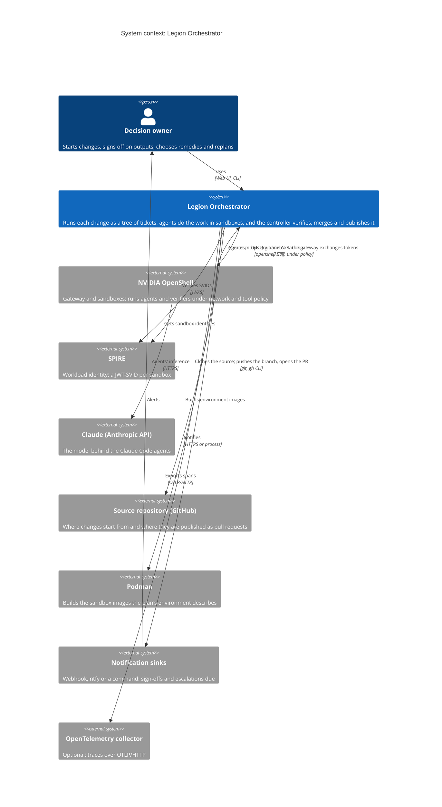
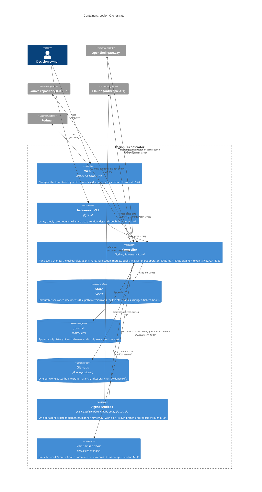
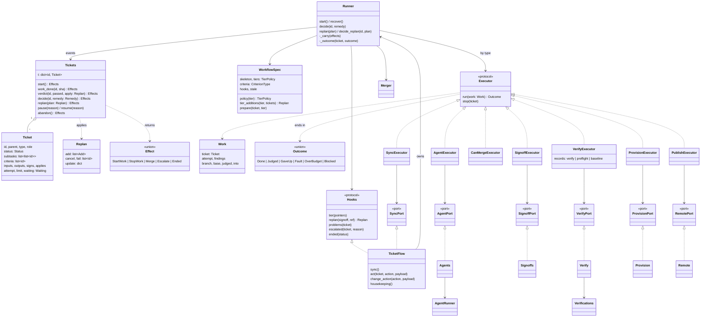

# C4 model: how the application is organised

The application is shown here at four levels of zoom, following the [C4 model](https://c4model.com):

1. **System context:** who uses the system and what it depends on.
2. **Containers:** the processes and data stores it is made of.
3. **Components:** the parts of the controller.
4. **Code:** the classes at the centre of the workflow.

The diagrams are Mermaid, and GitHub renders them.

[architecture.md](architecture.md) covers the layers in more depth: what each one decides and what it may know. [WORKFLOW.md](../WORKFLOW.md) is the specification of the workflow itself.

## 1. System context

Legion Orchestrator turns a goal into a reviewed, published change in a repository. It does the work with LLM agents, each in its own sandbox, and it checks every claim an agent makes. Humans sign off on the outcomes and decide what happens when something fails.

Sandboxes only make outbound calls, and only to what their policy allows: the controller's agent-facing listeners and the model provider. GitHub credentials are the host's, and no sandbox ever holds them.

## 2. Containers

The controller is one Python process, with an operator listener and four agent-facing listeners, one protocol per port so the gateway's policy can be exact. Its only durable state is the SQLite database and the git hubs on disk. Everything else is rebuilt from those on restart.
The database's tables are drawn in [database.md](database.md).

With `sandbox.runner: local`, the sandboxes are local processes instead of OpenShell sandboxes, and an in-process stand-in replaces SPIRE. That mode is for development and tests.

## 3. Components of the controller

Each change has its own `ChangeEngine`. The ticket rules at its centre are pure: events go in and effects come out. Everything that does I/O sits below them, behind the executors' ports. The import contracts in `pyproject.toml` hold this shape, and `lint-imports` checks them.

```mermaid
C4Component
    title Components: the controller

    Container(ui, "Web UI")
    Container(agent, "Agent sandbox")
    ContainerDb(db, "Store (SQLite)")
    ContainerDb(hubs, "Git hubs")
    System_Ext(openshell, "OpenShell gateway")
    System_Ext(github, "GitHub")

    Container_Boundary(ctl, "Controller") {
        Component(web, "Operator API", "server/web.py, views.py, browse.py", "Change state, actions, documents, logs, event stream")
        Component(mcp, "MCP server", "server/mcp.py, store/mcp.py", "Agents' tools: assignment, documents, progress, report")
        Component(githttp, "Git smart-HTTP", "git/http.py", "Each run's bearer may push only its own branch")
        Component(token, "Token endpoint", "identity/", "Checks an SVID and its sandbox's binding, then issues an access token")
        Component(a2a, "A2A listener", "server/a2a.py, inbox.py", "Cards for the orchestrator and live tickets; inboxes; ask_human")
        Component(controller, "Controller", "engine/controller.py", "All changes: start, recover, look up, attention, notify")
        Component(engine, "ChangeEngine", "engine/change.py, compose.py", "One change: its layers, wired; the facade for the servers")
        Component(rules, "Ticket rules", "tickets/rules.py, model.py", "Pure: what each ticket does next, remedies, replans, the end")
        Component(spec, "Workflow spec", "tickets/spec.py, assets/workflows/*.yaml", "Skeleton, tier policies, criteria types, hooks, stale")
        Component(trunner, "Runner", "tickets/runner.py, stale.py", "Applies events under the change's lock, carries out effects, prepares replans")
        Component(execs, "Executors", "tickets/executors/", "One per ticket type: agent, sign-off, verify, sync, can-merge, provision, publish, and the merge")
        Component(flow, "TicketFlow and adapters", "engine/flow/", "The runner's hooks, the executors' ports, human actions, housekeeping")
        Component(services, "Services", "engine/services/", "AgentRunner, AgentRuns, Reports, RunLifecycle, Verification, Provisioner, Publisher, Resolver, cleanup")
        Component(roles, "Role handlers and guards", "workflow/roles/, guards/", "Per role: guards, context, prompt variables, what an accepted report says")
        Component(sbx, "Sandbox layer", "engine/sandboxes/, sandbox/", "Sessions, plans, reflections, consult turns; OpenShell and local runners")
        Component(disp, "Dispatcher", "engine/base/dispatch.py, work.py", "Runs Work within limits.max_parallel, shared by every change")
        Component(core, "ChangeCore and StateStore", "engine/base/", "The change's records and their saves")
        Component(gitc, "Branches and GitHub", "git/", "The hub's branches, merges, evidence refs; publishing")
    }

    Rel(ui, web, "JSON/HTTP")
    Rel(agent, mcp, "MCP")
    Rel(agent, githttp, "git")
    Rel(agent, a2a, "A2A")
    Rel(openshell, token, "Token exchange")
    Rel(web, controller, "Calls")
    Rel(mcp, engine, "Writes and reports")
    Rel(a2a, services, "Turns and inboxes", "bus")
    Rel(controller, engine, "One per change")
    Rel(engine, flow, "Fronts")
    Rel(flow, trunner, "Starts, feeds")
    Rel(trunner, rules, "Events in, effects out")
    Rel(trunner, spec, "Reads")
    Rel(trunner, execs, "Runs a ticket's work")
    Rel(execs, flow, "Ports")
    Rel(flow, services, "Uses")
    Rel(services, roles, "Checks reports with")
    Rel(services, disp, "Submits Work")
    Rel(disp, sbx, "Runs in a session")
    Rel(sbx, openshell, "openshell CLI")
    Rel(core, db, "Saves")
    Rel(execs, gitc, "Merges, publishes")
    Rel(gitc, hubs, "git")
    Rel(gitc, github, "gh")

    UpdateLayoutConfig($c4ShapeInRow="4", $c4BoundaryInRow="1")
```

| Component | Decides | Knows nothing about |
| --- | --- | --- |
| Ticket rules | What a ticket does next | Agents, sandboxes, git, the store, any I/O |
| Runner | Applying events and carrying out effects | What an executor does, the engine (it is given `Hooks`) |
| Executors | One ticket type's work, ending in one outcome | The services behind their ports |
| TicketFlow | The hooks, the ports filled by the services, human actions | How a service works |
| Services | A run, a verification, provisioning, publishing | The ticket rules, the next ticket |
| Dispatcher | When work runs | What the work is |

## 4. Code: the ticket workflow

The classes at the centre: the pure rules (`Tickets`), the `Runner` that drives them, and the executors with their ports. `TicketFlow` implements the runner's `Hooks`, and its adapters implement the ports.

| Class | Where |
| --- | --- |
| `Ticket`, `Status`, `Waiting`, `Remedy` | `workflow/tickets/model.py` |
| `Tickets`, `Replan`, `Add`, the effects | `workflow/tickets/rules.py` |
| `WorkflowSpec` | `workflow/tickets/spec.py` |
| `Runner`, `Hooks` | `workflow/tickets/runner.py` |
| `Executor`, `Work`, the outcomes | `workflow/tickets/executors/base.py` |
| The executors and their ports | `workflow/tickets/executors/*.py` |
| `TicketFlow` | `workflow/engine/flow/flow.py` |
| `Agents`, `Signoffs`, `Verify`, `Provision`, `Remote` | `workflow/engine/flow/adapters.py` |
| `AgentRunner` | `workflow/engine/services/agents/runner.py` |
| `Verifications` | `workflow/engine/services/verification.py` |

What happens on a build, step by step, is in [architecture.md §2](architecture.md#2-who-decides-what-control-cascades-through-the-layers).
