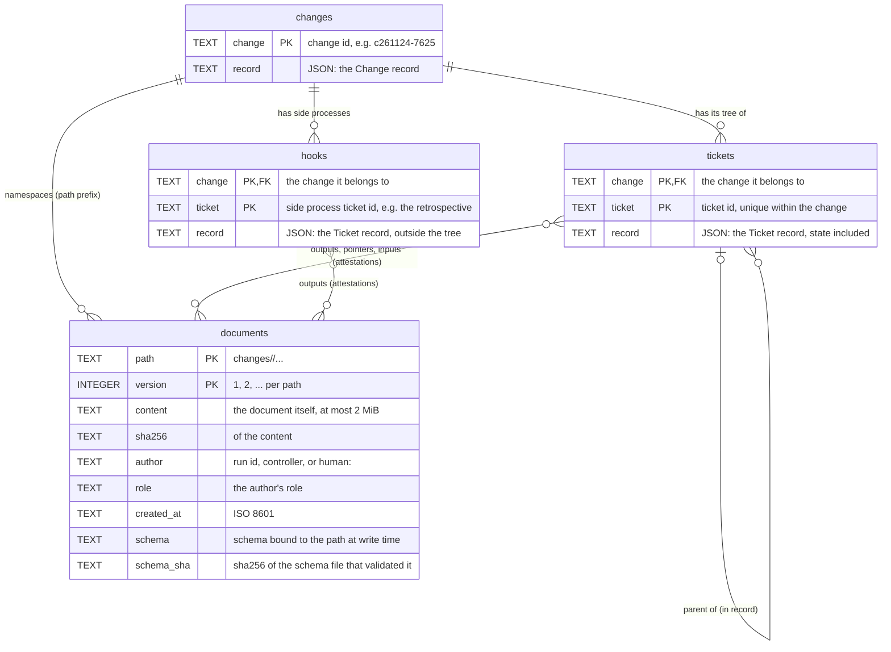

# The database schema

The controller has one SQLite database, the **Store** container in [c4.md](c4.md#2-containers). Its schema lives in two files:

- `legion_orch/store/docstore.py` defines `documents`.
- `legion_orch/store/state_tables.py` defines `changes`, `tickets` and `hooks`.

The database and the git hubs are the controller's only durable state. The journal (`store/journal.py`) is a separate JSON Lines file: it is the audit history and is never read on start.

## Tables

There are no SQL foreign keys. Every relation above is held by a value:

| Relation | Held by |
| --- | --- |
| A change's tickets and hooks | the `change` column, which matches `changes.change` |
| A ticket's parent, subtasks and criteria | `parent`, `subtasks` and `criteria` in its JSON `record`, which are ticket ids in the same change |
| A change's documents | the path prefix `changes/<change>/` |
| A ticket's documents | attestations, `file:<path>@<version>`, in its record: `outputs` (what its accepted report attests), the root's `pointers` (the approved version of each named output) and, by name, `inputs` |
| A ticket's agent runs | `runs` in its record: run ids, each a document at `changes/<change>/control/runs/<run id>` |

## Rules the schema enforces

- **Documents are immutable.** Two triggers, `documents_no_update` and `documents_no_delete`, abort any `UPDATE` or `DELETE`. A write is always a new version of its path, and the API checks it against the caller's base version. Every version can be addressed as `file:<path>@<version>`.
- **Every document is validated.** It is checked against the JSON Schema bound to its path (`assets/schemas/`), and the schema's name and hash are recorded with it.
- **The state tables hold current values only.** A save upserts the rows that changed and deletes the dropped ones, in one transaction. History goes to the journal. On restart, the controller loads every change from `changes`, then its `tickets` and `hooks` in the order they were first written (by `rowid`).

## What the documents hold

Everything a change writes is a document under `changes/<change>/`:

| Path | What |
| --- | --- |
| `tickets/<ticket>/...` | the agents' documents per ticket: requirements, spec, oracle, environment, `tickets.json`, reviews, sign-off decisions |
| `control/runs/<run>` | an agent run's record: its assignment and outcome |
| `control/runs/<run>/log`, `control/logs/<run>.log` | run logs |
| `control/digests/<run>.json` | per-run digests for the retrospective |
| `control/reflections/<run>.md` | an agent's reflection on its session |
| `control/environment/` | the provisioned environment's build record and log |
| `control/proposals/...` | the resolver's proposals |
| `control/assets/<sha>/...` | the asset set a run was pinned to |
| `control/goal.md`, `control/pr.json`, `control/ended.json` | the change's goal, its pull request, how it ended |

The JSON in `changes.record` is the `Change` model (`workflow/model.py`). It holds:

- **Identity:** id, goal and workspace.
- **Status:** status, tier and risk.
- **Its base:** `base_sha` and `blank_repo`.
- **Its environment:** `environment` and `setup_pin`.
- **How it ended:** `ended`, `completed`, `cleaned_at` and `pruned_at`.
- **Open items:** the agents' questions, verifications and the resolver's proposals.

The JSON in `tickets.record` and `hooks.record` is the `Ticket` model (`workflow/tickets/model.py`). It holds:

- **Its place in the tree:** id, parent, type, role, `subtasks` and `criteria`.
- **Its contract:** `inputs`, `work`, `signs`, `applies`, `severity`, `waivable` and `limit`.
- **Its state:** status, attempt, `waiting`, findings, sha, `outputs`, `runs` and `sandbox`.
- **Root only:** `pointers` and `paused`.
